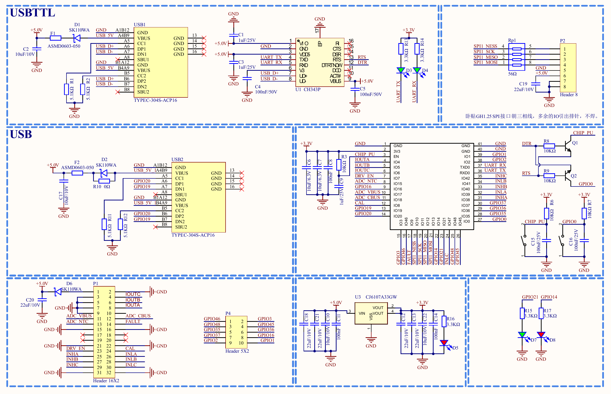
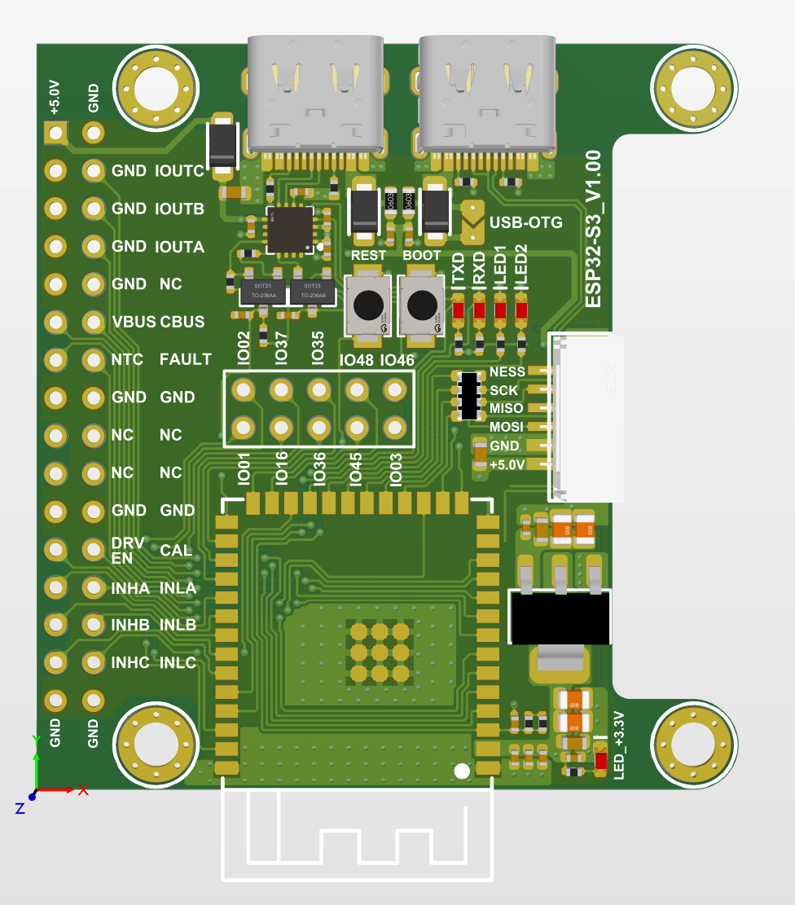
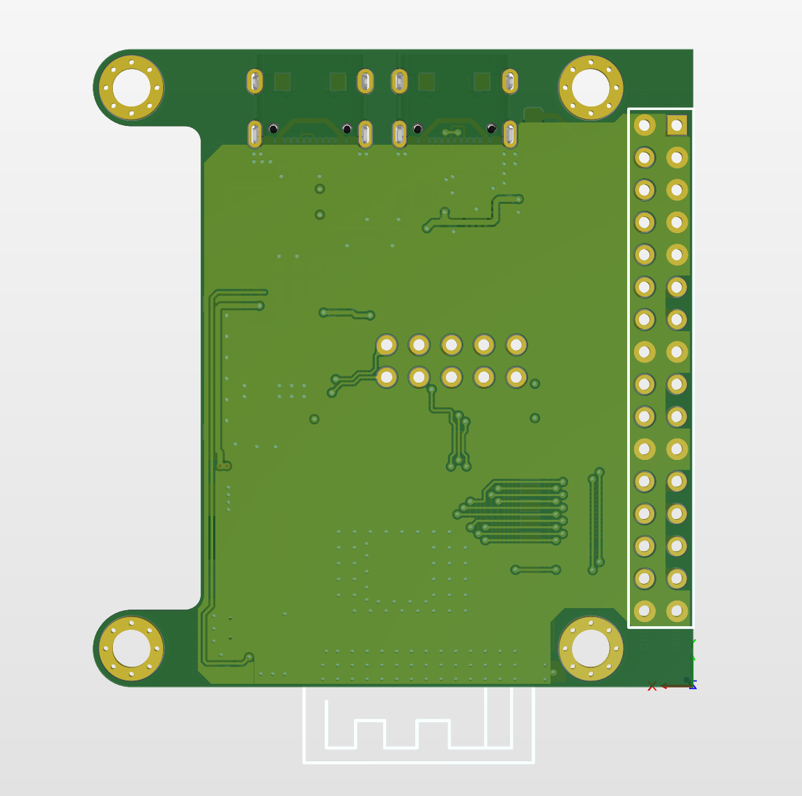

# **LOGIC_ESP32 V1.0x 三相无刷电机控制板产品说明书**

## 文档版本

- Rev.1.00（2026.11.11）初版，包含板卡接口、接线说明及 SimpleFOC 使用方法。

  
   图 1　LOGIC_ESP32 V1.0x 控制板原理图（点击查看完整 PDF）

  

    

    图 2　正面效果图
  

  

    

    图 3　背面效果图
  

## **注意事项**

- 插拔控制板、功率板、编码器或电机相线前，断开 USB 和功率母线，并确认母线已放电。
- 首次上电前核对 P1 的 1 脚方向、电源极性及公共地。直流母线接功率板电源端子。
- 首次调试使用限流电源，固定电机并为转轴留出活动空间。启动对齐期间电机可能转动。

## **快速使用**

1. **选择功率板。** 快速使用默认按 POWER_DRV8323HR（12～40 V）说明。烧录前打开 hardware_config.h，确认 POWER_BOARD 为 PowerBoard::Drv8323Hr。使用 POWER_DRV8353HR（12～60 V）时，将 POWER_BOARD 设为 PowerBoard::Drv8353Hr，再编译烧录。
2. **设置电机和编码器。** 在 hardware_config.h 中配置电机极对数（POLE_PAIRS）、相电阻（PHASE_RESISTANCE_OHM，单位 Ω）和相电感（PHASE_INDUCTANCE_MH，单位 mH）。参考例程使用 MT6835，使用其他 SPI 编码器时需自行修改程序。
3. **编译并烧录。** 用 Arduino IDE 打开 simple_foc_original.ino，选择 ESP32S3 Dev Module。参考依赖版本为 Arduino-ESP32 3.3.11、Simple FOC 2.4.0 和 SimpleFOCDrivers 1.0.9。断开功率母线，数据线接 USB1，选择板载 CH343P USB 转 TTL 对应的 COM 口上传。
4. **接线并上电。** 断电接好控制板、功率板、三相无刷电机和兼容的 SPI 编码器。上电后打开同一 COM 口，设置 115200、8N1，行尾选择 LF 换行。需要查看完整启动日志时，打开串口后按 REST 复位。
5. **发送目标电流。** 等待 Motor ready. Set target current with T&lt;ampere&gt;. 提示。首次调试可发送 T0.1 观察电机响应。T-0.1 请求反向转矩，T0 将目标电流归零。

### 使用须知

- **启动对齐期间电机可能转动。** 通电前固定电机并留出转动空间。
- **T 设置 Q 轴目标电流。** 单位为 A，限幅为 ±2 A。电机转速随负载变化。
- **T0 归零后驱动仍保持使能。** 当前示例只提供 T 命令。需要关断驱动功率时，按设备的供电关断流程切断功率母线。
- **出现 [FAIL] 时先排除故障，再复位。** 首次上电失败时优先核对 POWER_BOARD、母线电压、电机相线及编码器接线。

## **1. 产品概述**

<table style="width: 100%; border-collapse: collapse; text-align: left; font-size: 12px; table-layout: auto;">
  <thead>
    <tr style="background-color: #e0dede; color: black;">
      <th style="border: 1px solid #000; padding: 4px 6px;font-weight: bold; width: 1px; min-width: 60px; white-space: nowrap;">项目</th>
      <th style="border: 1px solid #000; padding: 4px 6px;font-weight: bold; width: 100%; white-space: normal;">内容</th>
    </tr>
  </thead>
  <tbody>
    <tr style="background-color: #ffffff; color: black; height: 20px;">
      <td align="left" style="text-align: left !important; border: 1px solid #000; padding: 3px 6px; width: 1px; min-width: 60px; white-space: nowrap;">适用硬件</td>
      <td align="left" style="text-align: left !important; border: 1px solid #000; padding: 3px 6px; width: 100%; white-space: normal;">LOGIC_ESP32 V1.x</td>
    </tr>
    <tr style="background-color: #ffffff; color: black; height: 20px;">
      <td align="left" style="text-align: left !important; border: 1px solid #000; padding: 3px 6px; width: 1px; min-width: 60px; white-space: nowrap;">参考软件</td>
      <td align="left" style="text-align: left !important; border: 1px solid #000; padding: 3px 6px; width: 100%; white-space: normal;">SimpleFOC Original Edition，按所配功率板选择固件配置</td>
    </tr>
    <tr style="background-color: #ffffff; color: black; height: 20px;">
      <td align="left" style="text-align: left !important; border: 1px solid #000; padding: 3px 6px; width: 1px; min-width: 60px; white-space: nowrap;">适用场景</td>
      <td align="left" style="text-align: left !important; border: 1px solid #000; padding: 3px 6px; width: 100%; white-space: normal;">三相无刷电机的编码器反馈、 FOC 电流转矩调试</td>
    </tr>
  </tbody>
</table>

LOGIC_ESP32 以 ESP32-S3 为控制核心，向外接功率板输出六路 PWM 和驱动使能，接收三相电流、母线电压、母线电流、温度和故障反馈。板上提供 SPI 编码器接口和三相低侧电流采样输入，可用于 FOC 电流转矩控制。电机三相线与直流母线接在功率板上。

## **2. 硬件组成**

### 2.1 电源、USB 与按键

<table style="width: 100%; border-collapse: collapse; text-align: left; font-size: 12px; table-layout: auto;">
  <thead>
    <tr style="background-color: #e0dede; color: black;">
      <th style="border: 1px solid #000; padding: 4px 6px;font-weight: bold; width: 1px; min-width: 60px; white-space: nowrap;">部位</th>
      <th style="border: 1px solid #000; padding: 4px 6px;font-weight: bold; width: 100%; white-space: normal;">用途</th>
    </tr>
  </thead>
  <tbody>
    <tr style="background-color: #ffffff; color: black; height: 20px;">
      <td align="left" style="text-align: left !important; border: 1px solid #000; padding: 3px 6px; width: 1px; min-width: 60px; white-space: nowrap;">USB1，USB-TTL</td>
      <td align="left" style="text-align: left !important; border: 1px solid #000; padding: 3px 6px; width: 100%; white-space: normal;">Type-C，板载 CH343P 将 USB 转为 TTL 串口并连接 ESP32-S3 的 UART0。电脑识别出的 COM 口用于烧录和串口调试。ESP32-S3 TX 为 GPIO43，RX 为 GPIO44</td>
    </tr>
    <tr style="background-color: #ffffff; color: black; height: 20px;">
      <td align="left" style="text-align: left !important; border: 1px solid #000; padding: 3px 6px; width: 1px; min-width: 60px; white-space: nowrap;">USB2，原生 USB</td>
      <td align="left" style="text-align: left !important; border: 1px solid #000; padding: 3px 6px; width: 100%; white-space: normal;">Type-C，D− 接 GPIO19，D+ 接 GPIO20。</td>
    </tr>
    <tr style="background-color: #ffffff; color: black; height: 20px;">
      <td align="left" style="text-align: left !important; border: 1px solid #000; padding: 3px 6px; width: 1px; min-width: 60px; white-space: nowrap;">P1-1</td>
      <td align="left" style="text-align: left !important; border: 1px solid #000; padding: 3px 6px; width: 100%; white-space: normal;">功率板 +5 V 输出经 D6 送入控制板</td>
    </tr>
    <tr style="background-color: #ffffff; color: black; height: 20px;">
      <td align="left" style="text-align: left !important; border: 1px solid #000; padding: 3px 6px; width: 1px; min-width: 60px; white-space: nowrap;">板内电源</td>
      <td align="left" style="text-align: left !important; border: 1px solid #000; padding: 3px 6px; width: 100%; white-space: normal;">5 V 经 U3 稳压得到 3.3 V，D5 为 3.3 V 电源指示</td>
    </tr>
    <tr style="background-color: #ffffff; color: black; height: 20px;">
      <td align="left" style="text-align: left !important; border: 1px solid #000; padding: 3px 6px; width: 1px; min-width: 60px; white-space: nowrap;">REST / BOOT</td>
      <td align="left" style="text-align: left !important; border: 1px solid #000; padding: 3px 6px; width: 100%; white-space: normal;">REST 拉低 CHIP_PU 复位，BOOT 拉低 GPIO0。</td>
    </tr>
    <tr style="background-color: #ffffff; color: black; height: 20px;">
      <td align="left" style="text-align: left !important; border: 1px solid #000; padding: 3px 6px; width: 1px; min-width: 60px; white-space: nowrap;">TXD / RXD</td>
      <td align="left" style="text-align: left !important; border: 1px solid #000; padding: 3px 6px; width: 100%; white-space: normal;">CH343P 串口通讯指示。</td>
    </tr>
    <tr style="background-color: #ffffff; color: black; height: 20px;">
      <td align="left" style="text-align: left !important; border: 1px solid #000; padding: 3px 6px; width: 1px; min-width: 60px; white-space: nowrap;">用户指示灯</td>
      <td align="left" style="text-align: left !important; border: 1px solid #000; padding: 3px 6px; width: 100%; white-space: normal;">D7 接 GPIO21，D8 接 GPIO14。</td>
    </tr>
  </tbody>
</table>

板卡接线与更换应在 USB 和功率母线均断开、母线放电后进行。USB2 的 5 V 路径在原理图中有 R10（0 Ω）并联在 D2 两端。若实物装有 R10，功率板供电时避免同时接入会提供 VBUS 的原生 USB 主机。烧录和串口调试使用 USB1。母线电源只能接功率板的电源端子，P1 上的 VBUS 是分压后的模拟反馈。

## **3. 接口说明**

### 3.1 外观与接口位置

按正面图方向，左侧为 P1 功率板接口，顶部左侧为 USB-TTL，顶部右侧为原生 USB，右侧为 SPI 编码器接口，中部为 GPIO 扩展焊盘。板图显示四个安装孔。孔距、板厚和外形尺寸以实物或正式结构图为准。

### 3.2 P1 功率板接口

P1 为 2×16 接口，对接功率板 P2。控制板正面图靠近 USB 端的方形焊盘为 1 脚。两板通电前按脚号确认方向，避免反插或错位。表中方向以控制板为基准。

<table style="width: 100%; border-collapse: collapse; text-align: left; font-size: 12px; table-layout: auto;">
  <thead>
    <tr style="background-color: #e0dede; color: black;">
      <th style="border: 1px solid #000; padding: 4px 6px;font-weight: bold; width: 1px; min-width: 60px; white-space: nowrap;">引脚</th>
      <th style="border: 1px solid #000; padding: 4px 6px;font-weight: bold; width: 1px; min-width: 60px; white-space: nowrap;">信号</th>
      <th style="border: 1px solid #000; padding: 4px 6px;font-weight: bold; width: 1px; min-width: 60px; white-space: nowrap;">GPIO</th>
      <th style="border: 1px solid #000; padding: 4px 6px;font-weight: bold; width: 1px; min-width: 60px; white-space: nowrap;">方向</th>
      <th style="border: 1px solid #000; padding: 4px 6px;font-weight: bold; width: 100%; white-space: normal;">说明</th>
    </tr>
  </thead>
  <tbody>
    <tr style="background-color: #ffffff; color: black; height: 20px;">
      <td align="left" style="text-align: left !important; border: 1px solid #000; padding: 3px 6px; width: 1px; min-width: 60px; white-space: nowrap;">1</td>
      <td align="left" style="text-align: left !important; border: 1px solid #000; padding: 3px 6px; width: 1px; min-width: 60px; white-space: nowrap;">+5 V</td>
      <td align="left" style="text-align: left !important; border: 1px solid #000; padding: 3px 6px; width: 1px; min-width: 60px; white-space: nowrap;">—</td>
      <td align="left" style="text-align: left !important; border: 1px solid #000; padding: 3px 6px; width: 1px; min-width: 60px; white-space: nowrap;">输入</td>
      <td align="left" style="text-align: left !important; border: 1px solid #000; padding: 3px 6px; width: 100%; white-space: normal;">控制板供电</td>
    </tr>
    <tr style="background-color: #ffffff; color: black; height: 20px;">
      <td align="left" style="text-align: left !important; border: 1px solid #000; padding: 3px 6px; width: 1px; min-width: 60px; white-space: nowrap;">2</td>
      <td align="left" style="text-align: left !important; border: 1px solid #000; padding: 3px 6px; width: 1px; min-width: 60px; white-space: nowrap;">GND</td>
      <td align="left" style="text-align: left !important; border: 1px solid #000; padding: 3px 6px; width: 1px; min-width: 60px; white-space: nowrap;">—</td>
      <td align="left" style="text-align: left !important; border: 1px solid #000; padding: 3px 6px; width: 1px; min-width: 60px; white-space: nowrap;">—</td>
      <td align="left" style="text-align: left !important; border: 1px solid #000; padding: 3px 6px; width: 100%; white-space: normal;">公共地</td>
    </tr>
    <tr style="background-color: #ffffff; color: black; height: 20px;">
      <td align="left" style="text-align: left !important; border: 1px solid #000; padding: 3px 6px; width: 1px; min-width: 60px; white-space: nowrap;">3</td>
      <td align="left" style="text-align: left !important; border: 1px solid #000; padding: 3px 6px; width: 1px; min-width: 60px; white-space: nowrap;">GND</td>
      <td align="left" style="text-align: left !important; border: 1px solid #000; padding: 3px 6px; width: 1px; min-width: 60px; white-space: nowrap;">—</td>
      <td align="left" style="text-align: left !important; border: 1px solid #000; padding: 3px 6px; width: 1px; min-width: 60px; white-space: nowrap;">—</td>
      <td align="left" style="text-align: left !important; border: 1px solid #000; padding: 3px 6px; width: 100%; white-space: normal;">公共地</td>
    </tr>
    <tr style="background-color: #ffffff; color: black; height: 20px;">
      <td align="left" style="text-align: left !important; border: 1px solid #000; padding: 3px 6px; width: 1px; min-width: 60px; white-space: nowrap;">4</td>
      <td align="left" style="text-align: left !important; border: 1px solid #000; padding: 3px 6px; width: 1px; min-width: 60px; white-space: nowrap;">IOUTC</td>
      <td align="left" style="text-align: left !important; border: 1px solid #000; padding: 3px 6px; width: 1px; min-width: 60px; white-space: nowrap;">6</td>
      <td align="left" style="text-align: left !important; border: 1px solid #000; padding: 3px 6px; width: 1px; min-width: 60px; white-space: nowrap;">输入</td>
      <td align="left" style="text-align: left !important; border: 1px solid #000; padding: 3px 6px; width: 100%; white-space: normal;">C 相电流，ADC1</td>
    </tr>
    <tr style="background-color: #ffffff; color: black; height: 20px;">
      <td align="left" style="text-align: left !important; border: 1px solid #000; padding: 3px 6px; width: 1px; min-width: 60px; white-space: nowrap;">5</td>
      <td align="left" style="text-align: left !important; border: 1px solid #000; padding: 3px 6px; width: 1px; min-width: 60px; white-space: nowrap;">GND</td>
      <td align="left" style="text-align: left !important; border: 1px solid #000; padding: 3px 6px; width: 1px; min-width: 60px; white-space: nowrap;">—</td>
      <td align="left" style="text-align: left !important; border: 1px solid #000; padding: 3px 6px; width: 1px; min-width: 60px; white-space: nowrap;">—</td>
      <td align="left" style="text-align: left !important; border: 1px solid #000; padding: 3px 6px; width: 100%; white-space: normal;">公共地</td>
    </tr>
    <tr style="background-color: #ffffff; color: black; height: 20px;">
      <td align="left" style="text-align: left !important; border: 1px solid #000; padding: 3px 6px; width: 1px; min-width: 60px; white-space: nowrap;">6</td>
      <td align="left" style="text-align: left !important; border: 1px solid #000; padding: 3px 6px; width: 1px; min-width: 60px; white-space: nowrap;">IOUTB</td>
      <td align="left" style="text-align: left !important; border: 1px solid #000; padding: 3px 6px; width: 1px; min-width: 60px; white-space: nowrap;">5</td>
      <td align="left" style="text-align: left !important; border: 1px solid #000; padding: 3px 6px; width: 1px; min-width: 60px; white-space: nowrap;">输入</td>
      <td align="left" style="text-align: left !important; border: 1px solid #000; padding: 3px 6px; width: 100%; white-space: normal;">B 相电流，ADC1</td>
    </tr>
    <tr style="background-color: #ffffff; color: black; height: 20px;">
      <td align="left" style="text-align: left !important; border: 1px solid #000; padding: 3px 6px; width: 1px; min-width: 60px; white-space: nowrap;">7</td>
      <td align="left" style="text-align: left !important; border: 1px solid #000; padding: 3px 6px; width: 1px; min-width: 60px; white-space: nowrap;">GND</td>
      <td align="left" style="text-align: left !important; border: 1px solid #000; padding: 3px 6px; width: 1px; min-width: 60px; white-space: nowrap;">—</td>
      <td align="left" style="text-align: left !important; border: 1px solid #000; padding: 3px 6px; width: 1px; min-width: 60px; white-space: nowrap;">—</td>
      <td align="left" style="text-align: left !important; border: 1px solid #000; padding: 3px 6px; width: 100%; white-space: normal;">公共地</td>
    </tr>
    <tr style="background-color: #ffffff; color: black; height: 20px;">
      <td align="left" style="text-align: left !important; border: 1px solid #000; padding: 3px 6px; width: 1px; min-width: 60px; white-space: nowrap;">8</td>
      <td align="left" style="text-align: left !important; border: 1px solid #000; padding: 3px 6px; width: 1px; min-width: 60px; white-space: nowrap;">IOUTA</td>
      <td align="left" style="text-align: left !important; border: 1px solid #000; padding: 3px 6px; width: 1px; min-width: 60px; white-space: nowrap;">4</td>
      <td align="left" style="text-align: left !important; border: 1px solid #000; padding: 3px 6px; width: 1px; min-width: 60px; white-space: nowrap;">输入</td>
      <td align="left" style="text-align: left !important; border: 1px solid #000; padding: 3px 6px; width: 100%; white-space: normal;">A 相电流，ADC1</td>
    </tr>
    <tr style="background-color: #ffffff; color: black; height: 20px;">
      <td align="left" style="text-align: left !important; border: 1px solid #000; padding: 3px 6px; width: 1px; min-width: 60px; white-space: nowrap;">9</td>
      <td align="left" style="text-align: left !important; border: 1px solid #000; padding: 3px 6px; width: 1px; min-width: 60px; white-space: nowrap;">GND</td>
      <td align="left" style="text-align: left !important; border: 1px solid #000; padding: 3px 6px; width: 1px; min-width: 60px; white-space: nowrap;">—</td>
      <td align="left" style="text-align: left !important; border: 1px solid #000; padding: 3px 6px; width: 1px; min-width: 60px; white-space: nowrap;">—</td>
      <td align="left" style="text-align: left !important; border: 1px solid #000; padding: 3px 6px; width: 100%; white-space: normal;">公共地</td>
    </tr>
    <tr style="background-color: #ffffff; color: black; height: 20px;">
      <td align="left" style="text-align: left !important; border: 1px solid #000; padding: 3px 6px; width: 1px; min-width: 60px; white-space: nowrap;">10</td>
      <td align="left" style="text-align: left !important; border: 1px solid #000; padding: 3px 6px; width: 1px; min-width: 60px; white-space: nowrap;">NC</td>
      <td align="left" style="text-align: left !important; border: 1px solid #000; padding: 3px 6px; width: 1px; min-width: 60px; white-space: nowrap;">—</td>
      <td align="left" style="text-align: left !important; border: 1px solid #000; padding: 3px 6px; width: 1px; min-width: 60px; white-space: nowrap;">—</td>
      <td align="left" style="text-align: left !important; border: 1px solid #000; padding: 3px 6px; width: 100%; white-space: normal;">板图标为 NC，保留悬空</td>
    </tr>
    <tr style="background-color: #ffffff; color: black; height: 20px;">
      <td align="left" style="text-align: left !important; border: 1px solid #000; padding: 3px 6px; width: 1px; min-width: 60px; white-space: nowrap;">11</td>
      <td align="left" style="text-align: left !important; border: 1px solid #000; padding: 3px 6px; width: 1px; min-width: 60px; white-space: nowrap;">ADC_VBUS</td>
      <td align="left" style="text-align: left !important; border: 1px solid #000; padding: 3px 6px; width: 1px; min-width: 60px; white-space: nowrap;">17</td>
      <td align="left" style="text-align: left !important; border: 1px solid #000; padding: 3px 6px; width: 1px; min-width: 60px; white-space: nowrap;">输入</td>
      <td align="left" style="text-align: left !important; border: 1px solid #000; padding: 3px 6px; width: 100%; white-space: normal;">母线分压，ADC2</td>
    </tr>
    <tr style="background-color: #ffffff; color: black; height: 20px;">
      <td align="left" style="text-align: left !important; border: 1px solid #000; padding: 3px 6px; width: 1px; min-width: 60px; white-space: nowrap;">12</td>
      <td align="left" style="text-align: left !important; border: 1px solid #000; padding: 3px 6px; width: 1px; min-width: 60px; white-space: nowrap;">ADC_CBUS</td>
      <td align="left" style="text-align: left !important; border: 1px solid #000; padding: 3px 6px; width: 1px; min-width: 60px; white-space: nowrap;">18</td>
      <td align="left" style="text-align: left !important; border: 1px solid #000; padding: 3px 6px; width: 1px; min-width: 60px; white-space: nowrap;">输入</td>
      <td align="left" style="text-align: left !important; border: 1px solid #000; padding: 3px 6px; width: 100%; white-space: normal;">母线电流采样</td>
    </tr>
    <tr style="background-color: #ffffff; color: black; height: 20px;">
      <td align="left" style="text-align: left !important; border: 1px solid #000; padding: 3px 6px; width: 1px; min-width: 60px; white-space: nowrap;">13</td>
      <td align="left" style="text-align: left !important; border: 1px solid #000; padding: 3px 6px; width: 1px; min-width: 60px; white-space: nowrap;">ADC_NTC</td>
      <td align="left" style="text-align: left !important; border: 1px solid #000; padding: 3px 6px; width: 1px; min-width: 60px; white-space: nowrap;">15</td>
      <td align="left" style="text-align: left !important; border: 1px solid #000; padding: 3px 6px; width: 1px; min-width: 60px; white-space: nowrap;">输入</td>
      <td align="left" style="text-align: left !important; border: 1px solid #000; padding: 3px 6px; width: 100%; white-space: normal;">温度采样</td>
    </tr>
    <tr style="background-color: #ffffff; color: black; height: 20px;">
      <td align="left" style="text-align: left !important; border: 1px solid #000; padding: 3px 6px; width: 1px; min-width: 60px; white-space: nowrap;">14</td>
      <td align="left" style="text-align: left !important; border: 1px solid #000; padding: 3px 6px; width: 1px; min-width: 60px; white-space: nowrap;">FAULT</td>
      <td align="left" style="text-align: left !important; border: 1px solid #000; padding: 3px 6px; width: 1px; min-width: 60px; white-space: nowrap;">9</td>
      <td align="left" style="text-align: left !important; border: 1px solid #000; padding: 3px 6px; width: 1px; min-width: 60px; white-space: nowrap;">输入</td>
      <td align="left" style="text-align: left !important; border: 1px solid #000; padding: 3px 6px; width: 100%; white-space: normal;">低有效，核对功率板上拉</td>
    </tr>
    <tr style="background-color: #ffffff; color: black; height: 20px;">
      <td align="left" style="text-align: left !important; border: 1px solid #000; padding: 3px 6px; width: 1px; min-width: 60px; white-space: nowrap;">15</td>
      <td align="left" style="text-align: left !important; border: 1px solid #000; padding: 3px 6px; width: 1px; min-width: 60px; white-space: nowrap;">GND</td>
      <td align="left" style="text-align: left !important; border: 1px solid #000; padding: 3px 6px; width: 1px; min-width: 60px; white-space: nowrap;">—</td>
      <td align="left" style="text-align: left !important; border: 1px solid #000; padding: 3px 6px; width: 1px; min-width: 60px; white-space: nowrap;">—</td>
      <td align="left" style="text-align: left !important; border: 1px solid #000; padding: 3px 6px; width: 100%; white-space: normal;">公共地</td>
    </tr>
    <tr style="background-color: #ffffff; color: black; height: 20px;">
      <td align="left" style="text-align: left !important; border: 1px solid #000; padding: 3px 6px; width: 1px; min-width: 60px; white-space: nowrap;">16</td>
      <td align="left" style="text-align: left !important; border: 1px solid #000; padding: 3px 6px; width: 1px; min-width: 60px; white-space: nowrap;">GND</td>
      <td align="left" style="text-align: left !important; border: 1px solid #000; padding: 3px 6px; width: 1px; min-width: 60px; white-space: nowrap;">—</td>
      <td align="left" style="text-align: left !important; border: 1px solid #000; padding: 3px 6px; width: 1px; min-width: 60px; white-space: nowrap;">—</td>
      <td align="left" style="text-align: left !important; border: 1px solid #000; padding: 3px 6px; width: 100%; white-space: normal;">公共地</td>
    </tr>
    <tr style="background-color: #ffffff; color: black; height: 20px;">
      <td align="left" style="text-align: left !important; border: 1px solid #000; padding: 3px 6px; width: 1px; min-width: 60px; white-space: nowrap;">17</td>
      <td align="left" style="text-align: left !important; border: 1px solid #000; padding: 3px 6px; width: 1px; min-width: 60px; white-space: nowrap;">NC</td>
      <td align="left" style="text-align: left !important; border: 1px solid #000; padding: 3px 6px; width: 1px; min-width: 60px; white-space: nowrap;">—</td>
      <td align="left" style="text-align: left !important; border: 1px solid #000; padding: 3px 6px; width: 1px; min-width: 60px; white-space: nowrap;">—</td>
      <td align="left" style="text-align: left !important; border: 1px solid #000; padding: 3px 6px; width: 100%; white-space: normal;">保留悬空</td>
    </tr>
    <tr style="background-color: #ffffff; color: black; height: 20px;">
      <td align="left" style="text-align: left !important; border: 1px solid #000; padding: 3px 6px; width: 1px; min-width: 60px; white-space: nowrap;">18</td>
      <td align="left" style="text-align: left !important; border: 1px solid #000; padding: 3px 6px; width: 1px; min-width: 60px; white-space: nowrap;">NC</td>
      <td align="left" style="text-align: left !important; border: 1px solid #000; padding: 3px 6px; width: 1px; min-width: 60px; white-space: nowrap;">—</td>
      <td align="left" style="text-align: left !important; border: 1px solid #000; padding: 3px 6px; width: 1px; min-width: 60px; white-space: nowrap;">—</td>
      <td align="left" style="text-align: left !important; border: 1px solid #000; padding: 3px 6px; width: 100%; white-space: normal;">保留悬空</td>
    </tr>
    <tr style="background-color: #ffffff; color: black; height: 20px;">
      <td align="left" style="text-align: left !important; border: 1px solid #000; padding: 3px 6px; width: 1px; min-width: 60px; white-space: nowrap;">19</td>
      <td align="left" style="text-align: left !important; border: 1px solid #000; padding: 3px 6px; width: 1px; min-width: 60px; white-space: nowrap;">NC</td>
      <td align="left" style="text-align: left !important; border: 1px solid #000; padding: 3px 6px; width: 1px; min-width: 60px; white-space: nowrap;">—</td>
      <td align="left" style="text-align: left !important; border: 1px solid #000; padding: 3px 6px; width: 1px; min-width: 60px; white-space: nowrap;">—</td>
      <td align="left" style="text-align: left !important; border: 1px solid #000; padding: 3px 6px; width: 100%; white-space: normal;">保留悬空</td>
    </tr>
    <tr style="background-color: #ffffff; color: black; height: 20px;">
      <td align="left" style="text-align: left !important; border: 1px solid #000; padding: 3px 6px; width: 1px; min-width: 60px; white-space: nowrap;">20</td>
      <td align="left" style="text-align: left !important; border: 1px solid #000; padding: 3px 6px; width: 1px; min-width: 60px; white-space: nowrap;">NC</td>
      <td align="left" style="text-align: left !important; border: 1px solid #000; padding: 3px 6px; width: 1px; min-width: 60px; white-space: nowrap;">—</td>
      <td align="left" style="text-align: left !important; border: 1px solid #000; padding: 3px 6px; width: 1px; min-width: 60px; white-space: nowrap;">—</td>
      <td align="left" style="text-align: left !important; border: 1px solid #000; padding: 3px 6px; width: 100%; white-space: normal;">保留悬空</td>
    </tr>
    <tr style="background-color: #ffffff; color: black; height: 20px;">
      <td align="left" style="text-align: left !important; border: 1px solid #000; padding: 3px 6px; width: 1px; min-width: 60px; white-space: nowrap;">21</td>
      <td align="left" style="text-align: left !important; border: 1px solid #000; padding: 3px 6px; width: 1px; min-width: 60px; white-space: nowrap;">GND</td>
      <td align="left" style="text-align: left !important; border: 1px solid #000; padding: 3px 6px; width: 1px; min-width: 60px; white-space: nowrap;">—</td>
      <td align="left" style="text-align: left !important; border: 1px solid #000; padding: 3px 6px; width: 1px; min-width: 60px; white-space: nowrap;">—</td>
      <td align="left" style="text-align: left !important; border: 1px solid #000; padding: 3px 6px; width: 100%; white-space: normal;">公共地</td>
    </tr>
    <tr style="background-color: #ffffff; color: black; height: 20px;">
      <td align="left" style="text-align: left !important; border: 1px solid #000; padding: 3px 6px; width: 1px; min-width: 60px; white-space: nowrap;">22</td>
      <td align="left" style="text-align: left !important; border: 1px solid #000; padding: 3px 6px; width: 1px; min-width: 60px; white-space: nowrap;">GND</td>
      <td align="left" style="text-align: left !important; border: 1px solid #000; padding: 3px 6px; width: 1px; min-width: 60px; white-space: nowrap;">—</td>
      <td align="left" style="text-align: left !important; border: 1px solid #000; padding: 3px 6px; width: 1px; min-width: 60px; white-space: nowrap;">—</td>
      <td align="left" style="text-align: left !important; border: 1px solid #000; padding: 3px 6px; width: 100%; white-space: normal;">公共地</td>
    </tr>
    <tr style="background-color: #ffffff; color: black; height: 20px;">
      <td align="left" style="text-align: left !important; border: 1px solid #000; padding: 3px 6px; width: 1px; min-width: 60px; white-space: nowrap;">23</td>
      <td align="left" style="text-align: left !important; border: 1px solid #000; padding: 3px 6px; width: 1px; min-width: 60px; white-space: nowrap;">DRV_EN</td>
      <td align="left" style="text-align: left !important; border: 1px solid #000; padding: 3px 6px; width: 1px; min-width: 60px; white-space: nowrap;">7</td>
      <td align="left" style="text-align: left !important; border: 1px solid #000; padding: 3px 6px; width: 1px; min-width: 60px; white-space: nowrap;">输出</td>
      <td align="left" style="text-align: left !important; border: 1px solid #000; padding: 3px 6px; width: 100%; white-space: normal;">驱动使能，高有效</td>
    </tr>
    <tr style="background-color: #ffffff; color: black; height: 20px;">
      <td align="left" style="text-align: left !important; border: 1px solid #000; padding: 3px 6px; width: 1px; min-width: 60px; white-space: nowrap;">24</td>
      <td align="left" style="text-align: left !important; border: 1px solid #000; padding: 3px 6px; width: 1px; min-width: 60px; white-space: nowrap;">CAL</td>
      <td align="left" style="text-align: left !important; border: 1px solid #000; padding: 3px 6px; width: 1px; min-width: 60px; white-space: nowrap;">8</td>
      <td align="left" style="text-align: left !important; border: 1px solid #000; padding: 3px 6px; width: 1px; min-width: 60px; white-space: nowrap;">输出</td>
      <td align="left" style="text-align: left !important; border: 1px solid #000; padding: 3px 6px; width: 100%; white-space: normal;">电流采样校准信号。功率板对应引脚为 NC 时无需接线</td>
    </tr>
    <tr style="background-color: #ffffff; color: black; height: 20px;">
      <td align="left" style="text-align: left !important; border: 1px solid #000; padding: 3px 6px; width: 1px; min-width: 60px; white-space: nowrap;">25</td>
      <td align="left" style="text-align: left !important; border: 1px solid #000; padding: 3px 6px; width: 1px; min-width: 60px; white-space: nowrap;">INHA</td>
      <td align="left" style="text-align: left !important; border: 1px solid #000; padding: 3px 6px; width: 1px; min-width: 60px; white-space: nowrap;">38</td>
      <td align="left" style="text-align: left !important; border: 1px solid #000; padding: 3px 6px; width: 1px; min-width: 60px; white-space: nowrap;">输出</td>
      <td align="left" style="text-align: left !important; border: 1px solid #000; padding: 3px 6px; width: 100%; white-space: normal;">A 相上桥 PWM</td>
    </tr>
    <tr style="background-color: #ffffff; color: black; height: 20px;">
      <td align="left" style="text-align: left !important; border: 1px solid #000; padding: 3px 6px; width: 1px; min-width: 60px; white-space: nowrap;">26</td>
      <td align="left" style="text-align: left !important; border: 1px solid #000; padding: 3px 6px; width: 1px; min-width: 60px; white-space: nowrap;">INLA</td>
      <td align="left" style="text-align: left !important; border: 1px solid #000; padding: 3px 6px; width: 1px; min-width: 60px; white-space: nowrap;">39</td>
      <td align="left" style="text-align: left !important; border: 1px solid #000; padding: 3px 6px; width: 1px; min-width: 60px; white-space: nowrap;">输出</td>
      <td align="left" style="text-align: left !important; border: 1px solid #000; padding: 3px 6px; width: 100%; white-space: normal;">A 相下桥 PWM</td>
    </tr>
    <tr style="background-color: #ffffff; color: black; height: 20px;">
      <td align="left" style="text-align: left !important; border: 1px solid #000; padding: 3px 6px; width: 1px; min-width: 60px; white-space: nowrap;">27</td>
      <td align="left" style="text-align: left !important; border: 1px solid #000; padding: 3px 6px; width: 1px; min-width: 60px; white-space: nowrap;">INHB</td>
      <td align="left" style="text-align: left !important; border: 1px solid #000; padding: 3px 6px; width: 1px; min-width: 60px; white-space: nowrap;">40</td>
      <td align="left" style="text-align: left !important; border: 1px solid #000; padding: 3px 6px; width: 1px; min-width: 60px; white-space: nowrap;">输出</td>
      <td align="left" style="text-align: left !important; border: 1px solid #000; padding: 3px 6px; width: 100%; white-space: normal;">B 相上桥 PWM</td>
    </tr>
    <tr style="background-color: #ffffff; color: black; height: 20px;">
      <td align="left" style="text-align: left !important; border: 1px solid #000; padding: 3px 6px; width: 1px; min-width: 60px; white-space: nowrap;">28</td>
      <td align="left" style="text-align: left !important; border: 1px solid #000; padding: 3px 6px; width: 1px; min-width: 60px; white-space: nowrap;">INLB</td>
      <td align="left" style="text-align: left !important; border: 1px solid #000; padding: 3px 6px; width: 1px; min-width: 60px; white-space: nowrap;">41</td>
      <td align="left" style="text-align: left !important; border: 1px solid #000; padding: 3px 6px; width: 1px; min-width: 60px; white-space: nowrap;">输出</td>
      <td align="left" style="text-align: left !important; border: 1px solid #000; padding: 3px 6px; width: 100%; white-space: normal;">B 相下桥 PWM</td>
    </tr>
    <tr style="background-color: #ffffff; color: black; height: 20px;">
      <td align="left" style="text-align: left !important; border: 1px solid #000; padding: 3px 6px; width: 1px; min-width: 60px; white-space: nowrap;">29</td>
      <td align="left" style="text-align: left !important; border: 1px solid #000; padding: 3px 6px; width: 1px; min-width: 60px; white-space: nowrap;">INHC</td>
      <td align="left" style="text-align: left !important; border: 1px solid #000; padding: 3px 6px; width: 1px; min-width: 60px; white-space: nowrap;">42</td>
      <td align="left" style="text-align: left !important; border: 1px solid #000; padding: 3px 6px; width: 1px; min-width: 60px; white-space: nowrap;">输出</td>
      <td align="left" style="text-align: left !important; border: 1px solid #000; padding: 3px 6px; width: 100%; white-space: normal;">C 相上桥 PWM</td>
    </tr>
    <tr style="background-color: #ffffff; color: black; height: 20px;">
      <td align="left" style="text-align: left !important; border: 1px solid #000; padding: 3px 6px; width: 1px; min-width: 60px; white-space: nowrap;">30</td>
      <td align="left" style="text-align: left !important; border: 1px solid #000; padding: 3px 6px; width: 1px; min-width: 60px; white-space: nowrap;">INLC</td>
      <td align="left" style="text-align: left !important; border: 1px solid #000; padding: 3px 6px; width: 1px; min-width: 60px; white-space: nowrap;">47</td>
      <td align="left" style="text-align: left !important; border: 1px solid #000; padding: 3px 6px; width: 1px; min-width: 60px; white-space: nowrap;">输出</td>
      <td align="left" style="text-align: left !important; border: 1px solid #000; padding: 3px 6px; width: 100%; white-space: normal;">C 相下桥 PWM</td>
    </tr>
    <tr style="background-color: #ffffff; color: black; height: 20px;">
      <td align="left" style="text-align: left !important; border: 1px solid #000; padding: 3px 6px; width: 1px; min-width: 60px; white-space: nowrap;">31</td>
      <td align="left" style="text-align: left !important; border: 1px solid #000; padding: 3px 6px; width: 1px; min-width: 60px; white-space: nowrap;">GND</td>
      <td align="left" style="text-align: left !important; border: 1px solid #000; padding: 3px 6px; width: 1px; min-width: 60px; white-space: nowrap;">—</td>
      <td align="left" style="text-align: left !important; border: 1px solid #000; padding: 3px 6px; width: 1px; min-width: 60px; white-space: nowrap;">—</td>
      <td align="left" style="text-align: left !important; border: 1px solid #000; padding: 3px 6px; width: 100%; white-space: normal;">公共地</td>
    </tr>
    <tr style="background-color: #ffffff; color: black; height: 20px;">
      <td align="left" style="text-align: left !important; border: 1px solid #000; padding: 3px 6px; width: 1px; min-width: 60px; white-space: nowrap;">32</td>
      <td align="left" style="text-align: left !important; border: 1px solid #000; padding: 3px 6px; width: 1px; min-width: 60px; white-space: nowrap;">GND</td>
      <td align="left" style="text-align: left !important; border: 1px solid #000; padding: 3px 6px; width: 1px; min-width: 60px; white-space: nowrap;">—</td>
      <td align="left" style="text-align: left !important; border: 1px solid #000; padding: 3px 6px; width: 1px; min-width: 60px; white-space: nowrap;">—</td>
      <td align="left" style="text-align: left !important; border: 1px solid #000; padding: 3px 6px; width: 100%; white-space: normal;">公共地</td>
    </tr>
  </tbody>
</table>

### 3.3 P2 SPI 编码器接口

<table style="width: 100%; border-collapse: collapse; text-align: left; font-size: 12px; table-layout: auto;">
  <thead>
    <tr style="background-color: #e0dede; color: black;">
      <th style="border: 1px solid #000; padding: 4px 6px;font-weight: bold; width: 1px; min-width: 60px; white-space: nowrap;">引脚</th>
      <th style="border: 1px solid #000; padding: 4px 6px;font-weight: bold; width: 1px; min-width: 60px; white-space: nowrap;">信号</th>
      <th style="border: 1px solid #000; padding: 4px 6px;font-weight: bold; width: 1px; min-width: 60px; white-space: nowrap;">GPIO</th>
      <th style="border: 1px solid #000; padding: 4px 6px;font-weight: bold; width: 1px; min-width: 60px; white-space: nowrap;">方向</th>
      <th style="border: 1px solid #000; padding: 4px 6px;font-weight: bold; width: 100%; white-space: normal;">说明</th>
    </tr>
  </thead>
  <tbody>
    <tr style="background-color: #ffffff; color: black; height: 20px;">
      <td align="left" style="text-align: left !important; border: 1px solid #000; padding: 3px 6px; width: 1px; min-width: 60px; white-space: nowrap;">1</td>
      <td align="left" style="text-align: left !important; border: 1px solid #000; padding: 3px 6px; width: 1px; min-width: 60px; white-space: nowrap;">NESS / CS</td>
      <td align="left" style="text-align: left !important; border: 1px solid #000; padding: 3px 6px; width: 1px; min-width: 60px; white-space: nowrap;">10</td>
      <td align="left" style="text-align: left !important; border: 1px solid #000; padding: 3px 6px; width: 1px; min-width: 60px; white-space: nowrap;">输出</td>
      <td align="left" style="text-align: left !important; border: 1px solid #000; padding: 3px 6px; width: 100%; white-space: normal;">编码器片选</td>
    </tr>
    <tr style="background-color: #ffffff; color: black; height: 20px;">
      <td align="left" style="text-align: left !important; border: 1px solid #000; padding: 3px 6px; width: 1px; min-width: 60px; white-space: nowrap;">2</td>
      <td align="left" style="text-align: left !important; border: 1px solid #000; padding: 3px 6px; width: 1px; min-width: 60px; white-space: nowrap;">SCK</td>
      <td align="left" style="text-align: left !important; border: 1px solid #000; padding: 3px 6px; width: 1px; min-width: 60px; white-space: nowrap;">11</td>
      <td align="left" style="text-align: left !important; border: 1px solid #000; padding: 3px 6px; width: 1px; min-width: 60px; white-space: nowrap;">输出</td>
      <td align="left" style="text-align: left !important; border: 1px solid #000; padding: 3px 6px; width: 100%; white-space: normal;">时钟</td>
    </tr>
    <tr style="background-color: #ffffff; color: black; height: 20px;">
      <td align="left" style="text-align: left !important; border: 1px solid #000; padding: 3px 6px; width: 1px; min-width: 60px; white-space: nowrap;">3</td>
      <td align="left" style="text-align: left !important; border: 1px solid #000; padding: 3px 6px; width: 1px; min-width: 60px; white-space: nowrap;">MISO</td>
      <td align="left" style="text-align: left !important; border: 1px solid #000; padding: 3px 6px; width: 1px; min-width: 60px; white-space: nowrap;">12</td>
      <td align="left" style="text-align: left !important; border: 1px solid #000; padding: 3px 6px; width: 1px; min-width: 60px; white-space: nowrap;">输入</td>
      <td align="left" style="text-align: left !important; border: 1px solid #000; padding: 3px 6px; width: 100%; white-space: normal;">编码器至控制板</td>
    </tr>
    <tr style="background-color: #ffffff; color: black; height: 20px;">
      <td align="left" style="text-align: left !important; border: 1px solid #000; padding: 3px 6px; width: 1px; min-width: 60px; white-space: nowrap;">4</td>
      <td align="left" style="text-align: left !important; border: 1px solid #000; padding: 3px 6px; width: 1px; min-width: 60px; white-space: nowrap;">MOSI</td>
      <td align="left" style="text-align: left !important; border: 1px solid #000; padding: 3px 6px; width: 1px; min-width: 60px; white-space: nowrap;">13</td>
      <td align="left" style="text-align: left !important; border: 1px solid #000; padding: 3px 6px; width: 1px; min-width: 60px; white-space: nowrap;">输出</td>
      <td align="left" style="text-align: left !important; border: 1px solid #000; padding: 3px 6px; width: 100%; white-space: normal;">控制板至编码器</td>
    </tr>
    <tr style="background-color: #ffffff; color: black; height: 20px;">
      <td align="left" style="text-align: left !important; border: 1px solid #000; padding: 3px 6px; width: 1px; min-width: 60px; white-space: nowrap;">5</td>
      <td align="left" style="text-align: left !important; border: 1px solid #000; padding: 3px 6px; width: 1px; min-width: 60px; white-space: nowrap;">GND</td>
      <td align="left" style="text-align: left !important; border: 1px solid #000; padding: 3px 6px; width: 1px; min-width: 60px; white-space: nowrap;">—</td>
      <td align="left" style="text-align: left !important; border: 1px solid #000; padding: 3px 6px; width: 1px; min-width: 60px; white-space: nowrap;">—</td>
      <td align="left" style="text-align: left !important; border: 1px solid #000; padding: 3px 6px; width: 100%; white-space: normal;">公共地</td>
    </tr>
    <tr style="background-color: #ffffff; color: black; height: 20px;">
      <td align="left" style="text-align: left !important; border: 1px solid #000; padding: 3px 6px; width: 1px; min-width: 60px; white-space: nowrap;">6</td>
      <td align="left" style="text-align: left !important; border: 1px solid #000; padding: 3px 6px; width: 1px; min-width: 60px; white-space: nowrap;">+5 V</td>
      <td align="left" style="text-align: left !important; border: 1px solid #000; padding: 3px 6px; width: 1px; min-width: 60px; white-space: nowrap;">—</td>
      <td align="left" style="text-align: left !important; border: 1px solid #000; padding: 3px 6px; width: 1px; min-width: 60px; white-space: nowrap;">输出</td>
      <td align="left" style="text-align: left !important; border: 1px solid #000; padding: 3px 6px; width: 100%; white-space: normal;">编码器供电，按模块规格确认</td>
    </tr>
    <tr style="background-color: #ffffff; color: black; height: 20px;">
      <td align="left" style="text-align: left !important; border: 1px solid #000; padding: 3px 6px; width: 1px; min-width: 60px; white-space: nowrap;">7</td>
      <td align="left" style="text-align: left !important; border: 1px solid #000; padding: 3px 6px; width: 1px; min-width: 60px; white-space: nowrap;">GND</td>
      <td align="left" style="text-align: left !important; border: 1px solid #000; padding: 3px 6px; width: 1px; min-width: 60px; white-space: nowrap;">—</td>
      <td align="left" style="text-align: left !important; border: 1px solid #000; padding: 3px 6px; width: 1px; min-width: 60px; white-space: nowrap;">—</td>
      <td align="left" style="text-align: left !important; border: 1px solid #000; padding: 3px 6px; width: 100%; white-space: normal;">原理图接地，按实物可用端子确认</td>
    </tr>
    <tr style="background-color: #ffffff; color: black; height: 20px;">
      <td align="left" style="text-align: left !important; border: 1px solid #000; padding: 3px 6px; width: 1px; min-width: 60px; white-space: nowrap;">8</td>
      <td align="left" style="text-align: left !important; border: 1px solid #000; padding: 3px 6px; width: 1px; min-width: 60px; white-space: nowrap;">GND</td>
      <td align="left" style="text-align: left !important; border: 1px solid #000; padding: 3px 6px; width: 1px; min-width: 60px; white-space: nowrap;">—</td>
      <td align="left" style="text-align: left !important; border: 1px solid #000; padding: 3px 6px; width: 1px; min-width: 60px; white-space: nowrap;">—</td>
      <td align="left" style="text-align: left !important; border: 1px solid #000; padding: 3px 6px; width: 100%; white-space: normal;">原理图接地，按实物可用端子确认</td>
    </tr>
  </tbody>
</table>

效果图标出了前六个信号。接线按板端和编码器端定义逐针核对，确认编码器模块可用 5 V 供电且 SPI 信号与 3.3 V ESP32-S3 IO 兼容。编码器线与电机相线分开布置。

### 3.4 P4 GPIO 扩展焊盘

<table style="width: 100%; border-collapse: collapse; text-align: left; font-size: 12px; table-layout: auto;">
  <thead>
    <tr style="background-color: #e0dede; color: black;">
      <th style="border: 1px solid #000; padding: 4px 6px;font-weight: bold; width: 1px; min-width: 60px; white-space: nowrap;">引脚</th>
      <th style="border: 1px solid #000; padding: 4px 6px;font-weight: bold; width: 100%; white-space: normal;">GPIO</th>
    </tr>
  </thead>
  <tbody>
    <tr style="background-color: #ffffff; color: black; height: 20px;">
      <td align="left" style="text-align: left !important; border: 1px solid #000; padding: 3px 6px; width: 1px; min-width: 60px; white-space: nowrap;">1</td>
      <td align="left" style="text-align: left !important; border: 1px solid #000; padding: 3px 6px; width: 100%; white-space: normal;">46</td>
    </tr>
    <tr style="background-color: #ffffff; color: black; height: 20px;">
      <td align="left" style="text-align: left !important; border: 1px solid #000; padding: 3px 6px; width: 1px; min-width: 60px; white-space: nowrap;">2</td>
      <td align="left" style="text-align: left !important; border: 1px solid #000; padding: 3px 6px; width: 100%; white-space: normal;">3</td>
    </tr>
    <tr style="background-color: #ffffff; color: black; height: 20px;">
      <td align="left" style="text-align: left !important; border: 1px solid #000; padding: 3px 6px; width: 1px; min-width: 60px; white-space: nowrap;">3</td>
      <td align="left" style="text-align: left !important; border: 1px solid #000; padding: 3px 6px; width: 100%; white-space: normal;">48</td>
    </tr>
    <tr style="background-color: #ffffff; color: black; height: 20px;">
      <td align="left" style="text-align: left !important; border: 1px solid #000; padding: 3px 6px; width: 1px; min-width: 60px; white-space: nowrap;">4</td>
      <td align="left" style="text-align: left !important; border: 1px solid #000; padding: 3px 6px; width: 100%; white-space: normal;">45</td>
    </tr>
    <tr style="background-color: #ffffff; color: black; height: 20px;">
      <td align="left" style="text-align: left !important; border: 1px solid #000; padding: 3px 6px; width: 1px; min-width: 60px; white-space: nowrap;">5</td>
      <td align="left" style="text-align: left !important; border: 1px solid #000; padding: 3px 6px; width: 100%; white-space: normal;">35</td>
    </tr>
    <tr style="background-color: #ffffff; color: black; height: 20px;">
      <td align="left" style="text-align: left !important; border: 1px solid #000; padding: 3px 6px; width: 1px; min-width: 60px; white-space: nowrap;">6</td>
      <td align="left" style="text-align: left !important; border: 1px solid #000; padding: 3px 6px; width: 100%; white-space: normal;">36</td>
    </tr>
    <tr style="background-color: #ffffff; color: black; height: 20px;">
      <td align="left" style="text-align: left !important; border: 1px solid #000; padding: 3px 6px; width: 1px; min-width: 60px; white-space: nowrap;">7</td>
      <td align="left" style="text-align: left !important; border: 1px solid #000; padding: 3px 6px; width: 100%; white-space: normal;">37</td>
    </tr>
    <tr style="background-color: #ffffff; color: black; height: 20px;">
      <td align="left" style="text-align: left !important; border: 1px solid #000; padding: 3px 6px; width: 1px; min-width: 60px; white-space: nowrap;">8</td>
      <td align="left" style="text-align: left !important; border: 1px solid #000; padding: 3px 6px; width: 100%; white-space: normal;">16</td>
    </tr>
    <tr style="background-color: #ffffff; color: black; height: 20px;">
      <td align="left" style="text-align: left !important; border: 1px solid #000; padding: 3px 6px; width: 1px; min-width: 60px; white-space: nowrap;">9</td>
      <td align="left" style="text-align: left !important; border: 1px solid #000; padding: 3px 6px; width: 100%; white-space: normal;">2</td>
    </tr>
    <tr style="background-color: #ffffff; color: black; height: 20px;">
      <td align="left" style="text-align: left !important; border: 1px solid #000; padding: 3px 6px; width: 1px; min-width: 60px; white-space: nowrap;">10</td>
      <td align="left" style="text-align: left !important; border: 1px solid #000; padding: 3px 6px; width: 100%; white-space: normal;">1</td>
    </tr>
  </tbody>
</table>

使用扩展焊盘前，按实装模组核对可用性、方向与启动绑带要求。本文的电机控制接线无需使用 P4。

## **4. 功率板选型与固件适配**

### 4.1 功率板配置对照

<table style="width: 100%; border-collapse: collapse; text-align: left; font-size: 12px; table-layout: auto;">
  <thead>
    <tr style="background-color: #e0dede; color: black;">
      <th style="border: 1px solid #000; padding: 4px 6px;font-weight: bold; width: 1px; min-width: 60px; white-space: nowrap;">项目</th>
      <th style="border: 1px solid #000; padding: 4px 6px;font-weight: bold; width: 1px; min-width: 60px; white-space: nowrap;">12～40 V 配置</th>
      <th style="border: 1px solid #000; padding: 4px 6px;font-weight: bold; width: 100%; white-space: normal;">12～60 V 配置</th>
    </tr>
  </thead>
  <tbody>
    <tr style="background-color: #ffffff; color: black; height: 20px;">
      <td align="left" style="text-align: left !important; border: 1px solid #000; padding: 3px 6px; width: 1px; min-width: 60px; white-space: nowrap;">软件母线电压范围</td>
      <td align="left" style="text-align: left !important; border: 1px solid #000; padding: 3px 6px; width: 1px; min-width: 60px; white-space: nowrap;">12～40 V</td>
      <td align="left" style="text-align: left !important; border: 1px solid #000; padding: 3px 6px; width: 100%; white-space: normal;">12～60 V</td>
    </tr>
    <tr style="background-color: #ffffff; color: black; height: 20px;">
      <td align="left" style="text-align: left !important; border: 1px solid #000; padding: 3px 6px; width: 1px; min-width: 60px; white-space: nowrap;">PWM 模式</td>
      <td align="left" style="text-align: left !important; border: 1px solid #000; padding: 3px 6px; width: 1px; min-width: 60px; white-space: nowrap;">参考装配为 6PWM</td>
      <td align="left" style="text-align: left !important; border: 1px solid #000; padding: 3px 6px; width: 100%; white-space: normal;">使用本示例前确认实物为 6PWM</td>
    </tr>
    <tr style="background-color: #ffffff; color: black; height: 20px;">
      <td align="left" style="text-align: left !important; border: 1px solid #000; padding: 3px 6px; width: 1px; min-width: 60px; white-space: nowrap;">相电流分流电阻</td>
      <td align="left" style="text-align: left !important; border: 1px solid #000; padding: 3px 6px; width: 1px; min-width: 60px; white-space: nowrap;">4 mΩ</td>
      <td align="left" style="text-align: left !important; border: 1px solid #000; padding: 3px 6px; width: 100%; white-space: normal;">2 mΩ</td>
    </tr>
    <tr style="background-color: #ffffff; color: black; height: 20px;">
      <td align="left" style="text-align: left !important; border: 1px solid #000; padding: 3px 6px; width: 1px; min-width: 60px; white-space: nowrap;">相电流放大增益</td>
      <td align="left" style="text-align: left !important; border: 1px solid #000; padding: 3px 6px; width: 1px; min-width: 60px; white-space: nowrap;">5 V/V</td>
      <td align="left" style="text-align: left !important; border: 1px solid #000; padding: 3px 6px; width: 100%; white-space: normal;">5 V/V</td>
    </tr>
    <tr style="background-color: #ffffff; color: black; height: 20px;">
      <td align="left" style="text-align: left !important; border: 1px solid #000; padding: 3px 6px; width: 1px; min-width: 60px; white-space: nowrap;">标称相电流换算灵敏度</td>
      <td align="left" style="text-align: left !important; border: 1px solid #000; padding: 3px 6px; width: 1px; min-width: 60px; white-space: nowrap;">20 mV/A</td>
      <td align="left" style="text-align: left !important; border: 1px solid #000; padding: 3px 6px; width: 100%; white-space: normal;">10 mV/A</td>
    </tr>
    <tr style="background-color: #ffffff; color: black; height: 20px;">
      <td align="left" style="text-align: left !important; border: 1px solid #000; padding: 3px 6px; width: 1px; min-width: 60px; white-space: nowrap;">母线分压</td>
      <td align="left" style="text-align: left !important; border: 1px solid #000; padding: 3px 6px; width: 1px; min-width: 60px; white-space: nowrap;">124 kΩ 与 4.7 kΩ</td>
      <td align="left" style="text-align: left !important; border: 1px solid #000; padding: 3px 6px; width: 100%; white-space: normal;">124 kΩ 与 4.7 kΩ</td>
    </tr>
    <tr style="background-color: #ffffff; color: black; height: 20px;">
      <td align="left" style="text-align: left !important; border: 1px solid #000; padding: 3px 6px; width: 1px; min-width: 60px; white-space: nowrap;">P2-24</td>
      <td align="left" style="text-align: left !important; border: 1px solid #000; padding: 3px 6px; width: 1px; min-width: 60px; white-space: nowrap;">CAL</td>
      <td align="left" style="text-align: left !important; border: 1px solid #000; padding: 3px 6px; width: 100%; white-space: normal;">NC</td>
    </tr>
  </tbody>
</table>

### 4.2 固件板型选择

在 hardware_config.h 中设置 POWER_BOARD，然后重新编译、烧录。首次上电前核对功率板的六路 PWM 模式、相电流采样参数、母线电压范围及 FAULT 电平。CAL 的接线以功率板接口定义为准。

若配置的分流电阻大于实际阻值，且放大增益设置正确，软件会低估电流反馈幅值。更换功率板后应重新完成 FOC 对齐，并核对电流采样方向及幅值。

### 4.3 母线电压换算

GPIO17 接收母线分压信号，按下式换算母线电压。首次调试用万用表测量功率板母线和 P1-11 对地电压，核对分压及接地。

VBUS = ADC_VBUS × (124000 + 4700) / 4700

软件母线窗口由 POWER_BOARD 决定，见第 4.1 节。调试电压还须符合实装功率板、电机和测试电源的要求。

## **5. 产品使用**

### 5.1 首次上电与停机

1. 断电连接 LOGIC_ESP32 的 P1 与功率板 P2，将与功率板电压、电流规格匹配的三相无刷电机接至 A/B/C，再将转子侧 SPI 编码器接至控制板 P2。按第 3.3 节核对针脚、供电和信号电平，并使用与编码器型号匹配的驱动。固定电机并留出转动空间，初次测试使用限流直流电源。
2. 送电前核对 POWER_BOARD、母线极性、两板共地、PWM 和 DRV_EN 的初始低电平。功率板引出 CAL 时，一并核对该信号的初始低电平。接通功率母线，打开 USB1 对应的 CH343P COM 口，必要时按 REST 复位。
3. 上电后等待 FOC 对齐完成。对齐期间电机可能转动，看到 Motor ready. Set target current with T&lt;ampere&gt;. 提示后再发送命令。
4. 发送 T0.1，观察电机响应。出现抖动、异响或明显过热时切断功率母线，排查后再上电。
5. 正常结束时可先发送 T0 将目标电流归零，再按设备的供电关断流程切断功率母线。断开 USB，确认母线放电后再调整接线。

### 5.2 串口命令

<table style="width: 100%; border-collapse: collapse; text-align: left; font-size: 12px; table-layout: auto;">
  <thead>
    <tr style="background-color: #e0dede; color: black;">
      <th style="border: 1px solid #000; padding: 4px 6px;font-weight: bold; width: 1px; min-width: 60px; white-space: nowrap;">命令</th>
      <th style="border: 1px solid #000; padding: 4px 6px;font-weight: bold; width: 100%; white-space: normal;">功能</th>
    </tr>
  </thead>
  <tbody>
    <tr style="background-color: #ffffff; color: black; height: 20px;">
      <td align="left" style="text-align: left !important; border: 1px solid #000; padding: 3px 6px; width: 1px; min-width: 60px; white-space: nowrap;">T0.1</td>
      <td align="left" style="text-align: left !important; border: 1px solid #000; padding: 3px 6px; width: 100%; white-space: normal;">将 Q 轴目标设为 0.1 A。负值对应反向转矩</td>
    </tr>
    <tr style="background-color: #ffffff; color: black; height: 20px;">
      <td align="left" style="text-align: left !important; border: 1px solid #000; padding: 3px 6px; width: 1px; min-width: 60px; white-space: nowrap;">T0</td>
      <td align="left" style="text-align: left !important; border: 1px solid #000; padding: 3px 6px; width: 100%; white-space: normal;">将目标电流设为零，驱动保持使能</td>
    </tr>
    <tr style="background-color: #ffffff; color: black; height: 20px;">
      <td align="left" style="text-align: left !important; border: 1px solid #000; padding: 3px 6px; width: 1px; min-width: 60px; white-space: nowrap;">T-0.1</td>
      <td align="left" style="text-align: left !important; border: 1px solid #000; padding: 3px 6px; width: 100%; white-space: normal;">将 Q 轴目标设为 −0.1 A，请求反向转矩</td>
    </tr>
  </tbody>
</table>

### 5.3 故障监测与采样

串口出现 [FAIL] 时，按设备的供电关断流程切断功率母线，排除故障后再上电复位。±2 A 为目标电流限幅。启动对齐期间不应依赖串口故障提示作为实时保护。CBUS 和 NTC 为采样输入，母线过流及过温保护须按实际功率板配置和整机方案确认。

## **6. 常见故障**

<table style="width: 100%; border-collapse: collapse; text-align: left; font-size: 12px; table-layout: auto;">
  <thead>
    <tr style="background-color: #e0dede; color: black;">
      <th style="border: 1px solid #000; padding: 4px 6px;font-weight: bold; width: 1px; min-width: 60px; white-space: nowrap;">现象</th>
      <th style="border: 1px solid #000; padding: 4px 6px;font-weight: bold; width: 100%; white-space: normal;">检查顺序</th>
    </tr>
  </thead>
  <tbody>
    <tr style="background-color: #ffffff; color: black; height: 20px;">
      <td align="left" style="text-align: left !important; border: 1px solid #000; padding: 3px 6px; width: 1px; min-width: 60px; white-space: nowrap;">无 COM 口或无串口输出</td>
      <td align="left" style="text-align: left !important; border: 1px solid #000; padding: 3px 6px; width: 100%; white-space: normal;">确认数据线接在板载 USB-TTL 端口（USB1），并在设备管理器中检查 CH343P 驱动及对应的 COM 口。串口设为 115200、8N1，复位观察启动日志</td>
    </tr>
    <tr style="background-color: #ffffff; color: black; height: 20px;">
      <td align="left" style="text-align: left !important; border: 1px solid #000; padding: 3px 6px; width: 1px; min-width: 60px; white-space: nowrap;">BUS_OUT_OF_RANGE</td>
      <td align="left" style="text-align: left !important; border: 1px solid #000; padding: 3px 6px; width: 100%; white-space: normal;">测量功率板母线电压，检查 POWER_BOARD、P1-11、分压参数与公共地。排除原因后复位</td>
    </tr>
    <tr style="background-color: #ffffff; color: black; height: 20px;">
      <td align="left" style="text-align: left !important; border: 1px solid #000; padding: 3px 6px; width: 1px; min-width: 60px; white-space: nowrap;">DRIVER_FAULT</td>
      <td align="left" style="text-align: left !important; border: 1px solid #000; padding: 3px 6px; width: 100%; white-space: normal;">关断并切断母线，检查供电、相间短路、功率板温度、FAULT 上拉和 6PWM 配置</td>
    </tr>
    <tr style="background-color: #ffffff; color: black; height: 20px;">
      <td align="left" style="text-align: left !important; border: 1px solid #000; padding: 3px 6px; width: 1px; min-width: 60px; white-space: nowrap;">DRIVER_INIT / MOTOR_INIT / CURRENT_SENSE_INIT</td>
      <td align="left" style="text-align: left !important; border: 1px solid #000; padding: 3px 6px; width: 100%; white-space: normal;">核对库版本、开发板配置、六路 PWM 及 GPIO4/5/6 的映射</td>
    </tr>
    <tr style="background-color: #ffffff; color: black; height: 20px;">
      <td align="left" style="text-align: left !important; border: 1px solid #000; padding: 3px 6px; width: 1px; min-width: 60px; white-space: nowrap;">FOC_ALIGNMENT</td>
      <td align="left" style="text-align: left !important; border: 1px solid #000; padding: 3px 6px; width: 100%; white-space: normal;">核对编码器供电与 SPI 顺序、磁体安装、实际极对数、相线与采样通道，确认转子可自由转动</td>
    </tr>
    <tr style="background-color: #ffffff; color: black; height: 20px;">
      <td align="left" style="text-align: left !important; border: 1px solid #000; padding: 3px 6px; width: 1px; min-width: 60px; white-space: nowrap;">低电流指令下抖动或反馈幅值偏差</td>
      <td align="left" style="text-align: left !important; border: 1px solid #000; padding: 3px 6px; width: 100%; white-space: normal;">关断后核对分流阻值、CSA 增益、相序、采样零点和电流 PI。记录启动日志及实测母线电压用于复查</td>
    </tr>
  </tbody>
</table>

## **机械尺寸**

